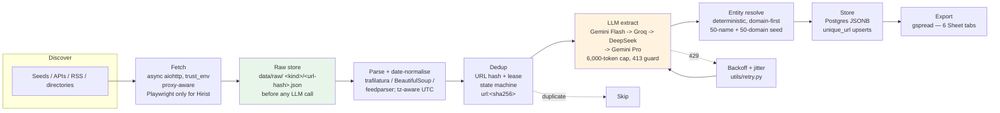

# Architecture — DataOrbit (FrontierAtlas ingestion pipeline)



Workers are async and stateless; scaling to 500k+ records = more
workers + Postgres/Redis capacity, no code change. The four
architecture questions from the brief (Phase VI — scale, 413s &
429s, freshness, storage) are answered in full in
`architecture.pdf`, generated by `scripts/build_architecture_pdf.py`.

## Data flow

```
Seeds / APIs / RSS / directories
  -> Discover        (crawlers/*.py — URL lists only)
                       YC sitemap (6,410 company URLs), BetaList
                       directory pages, arXiv + Hugging Face APIs,
                       5 news RSS feeds, 5 job boards
  -> Fetch           (crawlers/fetcher.py — aiohttp, bounded
                       concurrency via MAX_CONCURRENCY, rotating
                       user-agents, trust_env proxy-aware;
                       fetch_with_playwright only for JS-heavy
                       pages, e.g. Hirist; utils/http.py for
                       proxy-aware httpx clients)
  -> Raw store       (data/raw/<kind>/<url-hash>.json — before any
                       LLM call, so extraction can be re-run without
                       re-fetching and every row traces to a URL)
  -> Parse           (trafilatura / BeautifulSoup / feedparser;
                       date_utils normalises ISO-8601, RFC-822 and
                       relative dates to tz-aware UTC; undated items
                       fall back to article meta dates, then to the
                       first-seen store — crawlers/first_seen.py —
                       under the same 24h gate)
  -> Dedup           (storage/dedup.py — URL hash + idempotency key
                       url:<sha256>; lease state machine
                       pending -> processing -> completed / failed /
                       dead, 10-min renewable lease, in-memory
                       fallback when Redis is unavailable)
  -> LLM extract     (llm/orchestrator.py — Gemini Flash -> Groq
                       GPT-OSS -> DeepSeek -> Gemini Pro;
                       6,000-token per-call cap (chunk + merge), 413 guard;
                       utils/retry.py 429-only backoff + jitter;
                       LLM is a fallback — deterministic parse first)
  -> Resolve         (resolver/matcher.py — deterministic,
                       domain-first: seed domain -> exact normalised
                       name -> fuzzy >= 0.9 -> passthrough; returns
                       canonical + confidence + method)
  -> Store           (storage/db.py — Postgres, JSONB payloads,
                       unique_url upserts; JSON files always written)
  -> Export          (export/sheets.py — gspread, 6 tabs)
```

## Distributed crawling + scaling (Phase V / VI)

- **Stateless workers, config-driven scale.** Crawlers hold no
  state between runs; every tunable (targets, `MAX_CONCURRENCY`,
  timeouts, per-source delays) lives in `src/config.py` and `.env`.
  Scaling to 500,000+ records is infrastructure: raise
  `MAX_CONCURRENCY`, run more worker processes, grow Postgres/Redis
  capacity. No code change.
- **Bounded concurrency, polite by default.** `fetch_many` caps
  in-flight requests with an `asyncio.Semaphore`; per-source delays
  are honoured (arXiv 1 req/3s, BetaList 1s/page, Hirist 10s/page
  per robots.txt, GitHub 0.5s/call, Hugging Face 1s/query).
- **Idempotent by design.** Every URL moves through a lease state
  machine on its idempotency key (`url:<sha256>`): a worker claims
  it (`processing`, 10-minute lease, renewable by heartbeat), then
  marks it `completed` (permanent, never reprocessed) or `failed`
  (retryable with exponential backoff; dead-lettered after 3
  attempts). A crashed worker's lease simply expires and the URL
  becomes claimable again — no URL is ever blocked by a dead worker.
  Postgres upserts on `unique_url` make re-runs safe; raw-first
  storage means a failed extraction is re-extracted from disk,
  never re-fetched (`scripts/re_extract.py` re-runs the crawlers'
  `parse()` on `data/raw/` for startups and products).
- **One dead source never kills a run.** Each fetcher/parser logs a
  warning and the others continue (verified live: VentureBeat 429'd
  and the news run still returned 19 fresh items).
- **Current state vs. production design.** Dedup is a lease state
  machine in Redis (`storage/dedup.py`): atomic Lua transitions,
  an ownership token per claim (only the lease holder can renew,
  complete or fail a URL), a 10-minute renewable lease, and a
  process-local in-memory fallback with identical semantics when
  Redis is unavailable. Leases and heartbeats are implemented
  in-process in this demo — the runners are single-process and the
  coordinator does a final consistency pass. The remaining
  production step is a Redis work queue feeding N stateless
  workers. `architecture.pdf` Q1/Q3 describe the distributed
  design.

## Anti-bot posture (design / strategy only — no bypass tooling)

- **Challenge detection.** Treat 403s, 429s and challenge pages
  (Cloudflare / captcha interstitials) as a signal to stop, not to
  push harder: detect them by status code and page markers, back
  off with exponential delay, and log the URL for later review.
- **Fall back, don't fight.** Prefer an API, RSS feed or sitemap
  route wherever one exists; if a source challenges the crawler,
  the run continues with the other sources and the URL is queued
  for a later retry — never hammered.
- **Respect robots.txt** and per-source crawl delays (Hirist: 10s
  per robots.txt). Captchas are never solved or bypassed, and no
  code in this repo evades detection.
- **Playwright is for rendering, not evasion.** It renders
  JS-heavy pages (Hirist, a React SPA) after the plain fetch finds
  no content — the same pages a browser would show, fetched once
  and politely.

## Failure modes (Phase V — outline only, no bypass tooling)

- **Cloudflare challenge** — back off, rotate proxy / user-agent,
  fall back to Playwright rendering; prefer an API/RSS/sitemap
  route wherever one exists. Never hammer the endpoint.
- **Captcha trigger** — stop, log, queue the URL for later review;
  never attempt to solve or bypass a captcha.
- **Dynamic content** — Playwright render (`fetch_with_playwright`),
  wait for network idle, then extract as normal. Used in production
  for Hirist (React SPA); the crawler tries the plain fetch first
  and only renders when the raw HTML has no job links.
- **Rate limits (429)** — 429-only retry with exponential backoff +
  jitter (5 attempts), then fall through to the next LLM tier /
  next source. Per-source notes in `architecture.pdf` Q2.
- **Stale or dead feeds** — logged, skipped, run continues; the
  WWR category-feed staleness has a built-in fallback to the full
  feed (`src/crawlers/jobs.py`).

## Storage

- **Postgres (primary store).** Five tables (startups, products,
  papers, jobs, news), each `unique_url TEXT UNIQUE` + `payload
  JSONB` + `collected_at`. Relational integrity where it matters
  (the unique URL is the dedup backstop and the traceability key)
  with flexible JSONB payloads for schema-evolving fields; expression
  indexes on `payload ->> 'entityName'` and `payload ->> 'company'`
  for the queries evaluators run. Upserts make every run idempotent.
- **Redis (queue + dedup).** The lease state machine for the
  idempotency key (implemented in `storage/dedup.py`: atomic Lua
  transitions, ownership tokens, 10-minute renewable leases,
  failed-retry backoff and dead-lettering, with an in-memory
  fallback), and the designed work queue for distributed workers.
  Redis runs in docker-compose.
- **Raw files (`data/raw/`).** The audit trail and the cheap
  re-extraction source: every fetched payload is saved by URL hash
  before any LLM call.
- **Graph layer (future).** For mapping startup–product–paper–job
  relationships, pgvector (embeddings + similarity on the Postgres
  you already run) fits first; Neo4j fits when traversal queries
  ("which startups' products cite papers by authors who also work
  at…") become the workload. Neither is implemented in this demo —
  the resolver's deterministic matching is the entity layer for now.
  Full justification in `architecture.pdf` Q4.

## Project tree

```
DataOrbit/  (repo name; project: FrontierAtlas / GraphOne)
├── README.md  architecture.md  architecture.pdf
├── pyproject.toml  .env.example  docker-compose.yml
├── data/
│   ├── raw/<kind>/<url-hash>.json
│   └── processed/<Tab>.json
├── src/
│   ├── config.py  models.py
│   ├── crawlers/
│   │   ├── base.py  fetcher.py  date_utils.py  first_seen.py
│   │   ├── startups.py  products.py  papers.py  news.py  jobs.py
│   ├── llm/
│   │   ├── orchestrator.py  chunker.py  prompts.py  extractor.py
│   ├── resolver/
│   │   ├── matcher.py  seed_canonical.json  seed_canonical_domains.json
│   ├── storage/  db.py  dedup.py
│   ├── export/  sheets.py
│   └── utils/  http.py  logging.py  retry.py
├── scripts/
│   ├── run_bulk.py  run_fresh.py  export_sheets.py  re_extract.py
│   └── build_architecture_pdf.py
└── tests/
    ├── test_date_utils.py  test_resolver.py  test_chunker.py
    ├── test_models.py  test_http_utils.py
    ├── test_crawlers_bulk.py  test_crawlers_fresh.py
    ├── test_scripts.py  test_wiring.py
    ├── test_dedup.py  test_extractor.py
```
